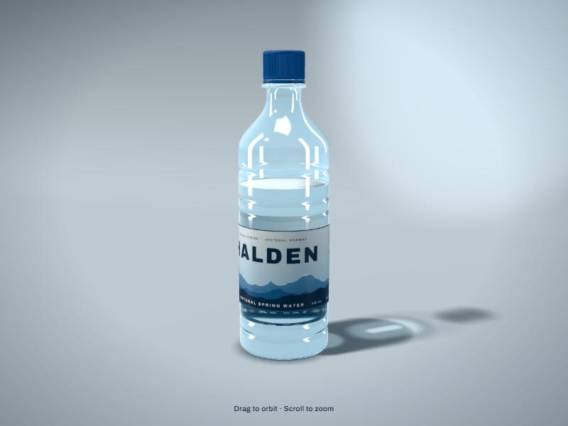

# Do Claude Code plugins change the quality of what it builds?

I noticed that the code and designs Claude Code made for me had become ugly and unstable. I suspected the plugins I had installed, so I ran a simple test on 2026-10-13: the same prompt, the same model, once with my plugins on and once with three of them switched off.

**In this one run, the build with those three plugins off looked clearly better.**

| Plugins on | Plugins off |
|---|---|
|  |  |

> **This is one run per side, with one prompt, judged by eye.** Results from AI models vary from run to run. Treat this as one experiment worth repeating, not as proof that the plugins caused the difference.

## What was compared

Both runs used the same setup:

- Tested 2026-10-13 with Claude Code 2.1.296, run headless with `claude -p`
- Model `claude-opus-5-5`. The original run passed the `opus` alias, which resolved to that model on the day; [run.sh](run.sh) now pins the full ID, so a re-run tests the same model
- The same prompt ([prompt.txt](prompt.txt)): a realistic 3D bottle of water in a single `index.html`, built with Three.js
- The same other plugins installed (about 20 in total; the exact list was not recorded)
- An empty folder for each run, both runs at the same time on one account

The only difference: the "off" run switched off these three plugins, for that run only, using [plugins-off.json](plugins-off.json):

| Plugin | What it does | Latest upstream commit on or before 2026-10-13 |
|---|---|---|
| [caveman](https://github.com/JuliusBrussee/caveman) | makes the assistant answer in very short, compressed language | `d262ab3` |
| [ponytail](https://github.com/DietrichGebert/ponytail) | tells the assistant to act like a "lazy senior developer" and write the least code possible | `2961b52` |
| [taste-skill](https://github.com/Leonxlnx/taste-skill) | a set of frontend design skills | `a60a36d` |

The commits are the newest upstream ones dated on or before the test day; the exact installed copies were not recorded. All three plugins have changed since, so a re-run today tests newer code.

I checked that the "off" run really started without them, using the plugin list Claude Code reports when a run starts. Those start-up logs were not committed, so you can't check this for the original run. `run.sh` now writes an evidence file per run with that list (see [Run it yourself](#run-it-yourself)).

## Results

| | Plugins on | Plugins off |
|---|---|---|
| How it looks | Milky white, nearly solid bottle; the water can't be seen. Plain label. | Clear plastic, visible water line, a branded label, soft shadow. Reads as a real product. |
| Console errors | None | None |
| Code size | 371 lines | 649 lines |
| Time | 4 min | 10 min |
| Cost (as reported by the CLI) | $1.14 | $2.21 |

Both builds are in [builds/](builds/). Open each `index.html` in a browser to see them move.

Read the time and cost rows with care. Both runs shared one account's rate limits and ran at the same time, and the "off" run wrote far more code, so the longer time partly reflects more output, not plugin overhead alone. The cost is the API-equivalent figure the CLI reports; on a subscription plan a run uses plan usage, not money.

## How it was judged

- **Looks:** by me, by eye, knowing which build was which. Nobody else rated them.
- **Console errors:** the runs had no browser or shell tool, so the models could not check this themselves. The "None" was a check made after the runs; how it was made was not recorded. To check it yourself, open each build with the browser's developer console open.
- **Screenshots:** both 800×600 JPG. The bottles rotate, and the camera angle and moment of each shot were not recorded.

## Why this might happen

According to the run logs (not committed), neither run called any of these plugins' skills directly. Caveman and ponytail work differently: they add instructions to the start of every session and every message, whether or not you ask for them. Ponytail's instruction is to write as little code as possible. The "on" run wrote less code, spent less and produced a weaker result, which fits a standing "do the minimum" instruction working against a task that asks for something to look as good as possible.

That is a guess, not something this test shows. It can't tell which of the three plugins made the difference, or whether it was the combination. One result doesn't fit the story neatly: taste-skill is a frontend design plugin, yet the run without it looked better.

## What I take from it

- Plugins that inject instructions into every session are not neutral. They can change how the model approaches every task, including ones they weren't meant for.
- If your output quality drops, try the same task with plugins off before blaming the model.
- Prefer plugins and skills you call on purpose over ones that are always on.

## A stronger test

A version of this that could separate the three plugins:

- 4 arms: all three on, and each one off alone ([arms/](arms/) has the three settings files)
- 3 runs per arm, run one after the other
- screenshots rated by someone who doesn't know which arm made which build
- the results in one small table, with each run's evidence file

```bash
bash run.sh --sequential --runs 3 arms/caveman-off.json arms/ponytail-off.json arms/taste-skill-off.json
```

That is 12 runs, about 6 times the cost of the pair reported here.

## Run it yourself

You need a signed-in `claude` CLI and Node.js. Running it uses your plan's usage (about $3 API-equivalent for one pair at the time of this test).

```bash
bash run.sh --sequential
```

- `--sequential` runs the arms one after the other, so they don't share rate limits. Without it, the arms run at the same time, as in the reported test.
- `--runs N` repeats every arm N times.
- Each settings file you pass is one more arm, named after the file. With none, the arms are `plugins-on` and `plugins-off` ([plugins-off.json](plugins-off.json)). The keys are `<plugin>@<marketplace>` as shown by `claude plugin list`.

Your runs go to `out/`; [builds/](builds/) holds the runs reported above. For each run, `out/<name>.evidence.json` holds the Claude Code version, model and plugin list from the start-up event, every tool call, and the time, output tokens and cost, with no prompt or answer text. Copy those files into an `evidence/` folder to publish them with your results. The script prints each run's exit code and exits non-zero if any run failed. Your global settings are not changed.

More runs and more prompts would make this much stronger. If you repeat it, I'd like to hear what you get.

## License

MIT. The plugins named above belong to their authors; this repo only reports one test of how they behaved together on one task.
