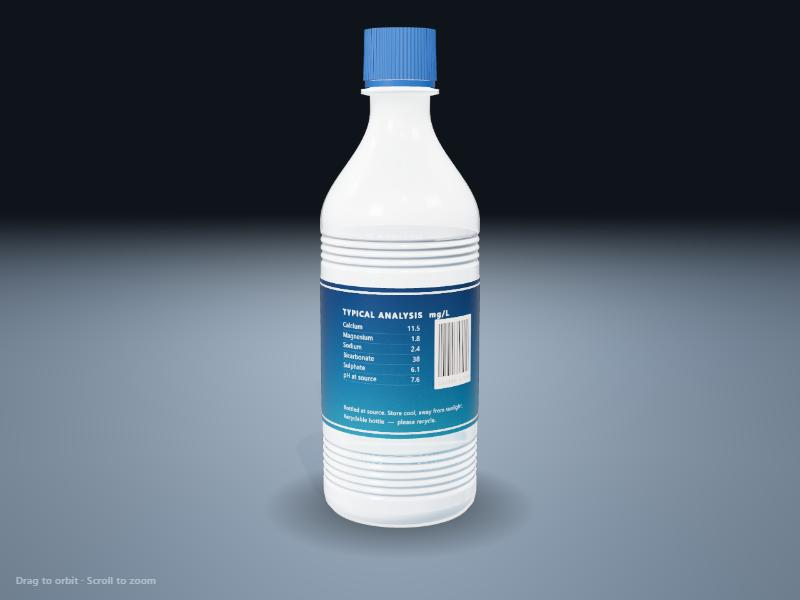
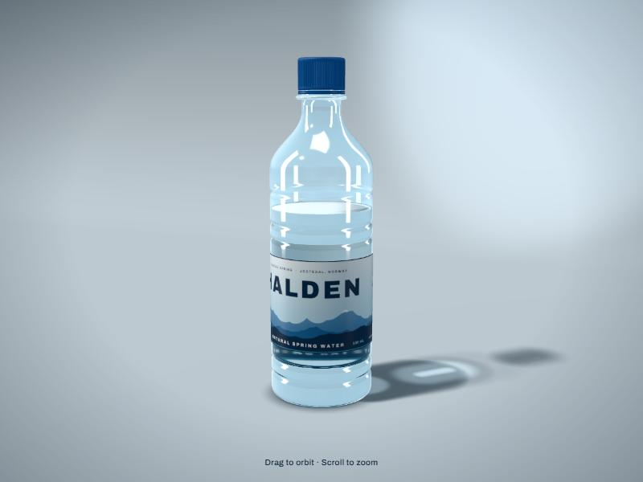

# Do Claude Code plugins change the quality of what it builds?

I noticed that the code and designs Claude Code made for me had become ugly and unstable. I suspected the plugins I had installed, so I ran a simple test: the same prompt, the same model, once with my plugins on and once with three of them switched off.

**The result: with those three plugins off, the build was clearly better.**

| Plugins on | Plugins off |
|---|---|
|  |  |

> **This is one run per side, with one prompt.** Results from AI models vary from run to run. Treat this as one experiment worth repeating, not as proof.

## What was compared

Both runs used the same setup:

- Claude Code 2.1.296, model `claude-opus-5-5`, run headless with `claude -p`
- The same prompt ([prompt.txt](prompt.txt)): a realistic 3D bottle of water in a single `index.html`, built with Three.js
- The same other plugins installed (about 20 in total)
- An empty folder for each run

The only difference: the "off" run switched off these three plugins, for that run only, using [plugins-off.json](plugins-off.json):

- [caveman](https://github.com/JuliusBrussee/caveman): makes the assistant answer in very short, compressed language
- [ponytail](https://github.com/DietrichGebert/ponytail): tells the assistant to act like a "lazy senior developer" and write the least code possible
- [taste-skill](https://github.com/Leonxlnx/taste-skill): a set of frontend design skills

I checked that the "off" run really started without them, using the plugin list Claude Code reports when a run starts.

## Results

| | Plugins on | Plugins off |
|---|---|---|
| How it looks | Milky white, nearly solid bottle; the water can't be seen. Plain label. | Clear plastic, visible water line, a branded label, soft shadow. Reads as a real product. |
| Console errors | None | None |
| Code size | 371 lines | 649 lines |
| Time | 4 min | 10 min |
| Cost (as reported by the CLI) | $1.14 | $2.21 |

Both builds are in [builds/](builds/). Open each `index.html` in a browser to see them move.

## Why this might happen

Neither run called any of these plugins' skills directly. Caveman and ponytail work differently: they add instructions to the start of every session and every message, whether or not you ask for them. Ponytail's instruction is to write as little code as possible. The "on" run followed that: it wrote less code, spent less, and produced a weaker result. For a task that asks for something to look as good as possible, a standing "do the minimum" instruction works against the goal.

This test can't tell which of the three plugins made the difference, or whether it was the combination.

## What I take from it

- Plugins that inject instructions into every session are not neutral. They change how the model approaches every task, including ones they weren't meant for.
- If your output quality drops, try the same task with plugins off before blaming the model.
- Prefer plugins and skills you call on purpose over ones that are always on.

## Run it yourself

You need a signed-in `claude` CLI. Running it uses your plan's usage (about $3 at the time of this test).

```bash
bash run.sh
```

This writes both builds to `out/`. Edit [plugins-off.json](plugins-off.json) to test other plugins; the keys are `<plugin>@<marketplace>` as shown by `claude plugin list`. Your global settings are not changed.

More runs and more prompts would make this much stronger. If you repeat it, I'd like to hear what you get.

## License

MIT. The plugins named above belong to their authors; this repo only reports one test of how they behaved together on one task.
